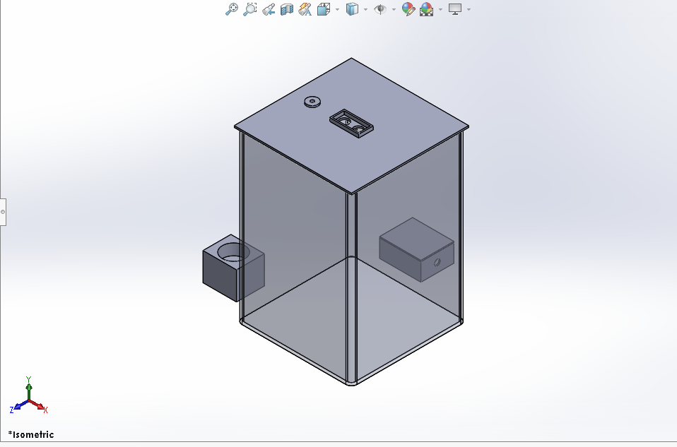
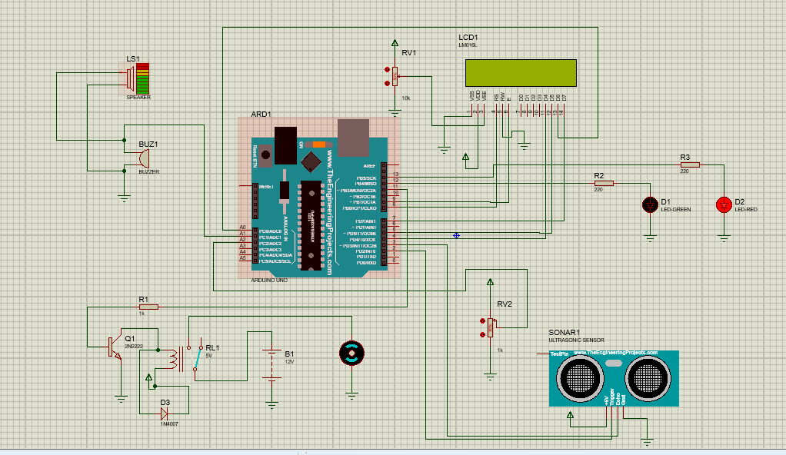
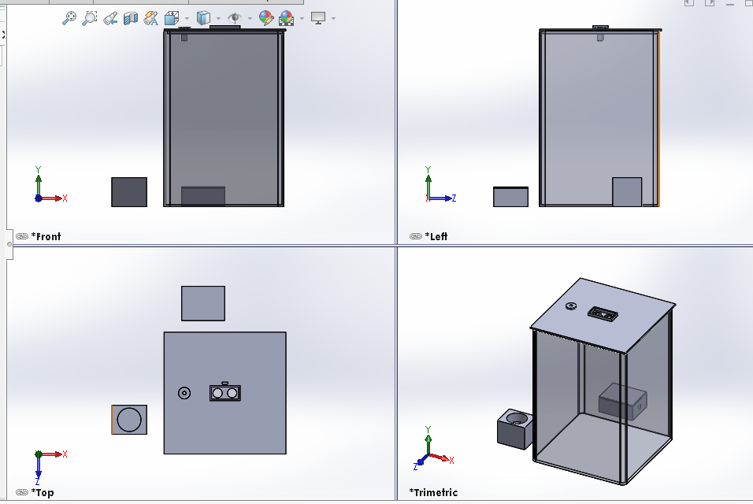

# Automatic Water Tank Monitoring and Pump Control

Course project by Prince Mutezva. An Arduino Uno measures the water level in a tank with an ultrasonic sensor,
shows it on an LCD and switches a 12 V pump automatically.

## How it works

- An HC-SR04 on the lid measures the distance to the water. The code converts it to a level in percent.
- The pump switches **ON at 30% or below** and **OFF at 90% or above**. Between the two the pump keeps its last state (hysteresis), so it does not switch rapidly.
- At 90% the LCD shows "Tank FULL" and the buzzer sounds.
- If the sensor gives no echo, the pump is forced OFF and the LCD shows "Sensor error".
- Green LED = pump running. Red LED = pump off.

## Hardware

Arduino Uno, HC-SR04, 16x2 LCD, green and red LEDs, buzzer, 5 V relay driven by a 2N2222, 12 V DC pump,
12 V supply with an LM2596 buck converter for the Uno. The pump runs only through the relay contacts.

| Function | Uno pin |
| --- | --- |
| HC-SR04 Trig / Echo | D2 / D3 |
| LCD RS / E | D8 / D9 |
| LCD D4 / D5 / D6 / D7 | D4 / D5 / A0 / D7 |
| Relay driver (via 1 k to the 2N2222 base) | D11 |
| Green LED | D12 |
| Red LED | D13 |
| Buzzer | A1 |

## Repository layout

| Folder | Contents |
| --- | --- |
| `firmware/water_tank/` | Arduino sketch `water_tank.ino` |
| `hardware/cad/` | SolidWorks parts and assembly |
| `hardware/stl/` | STL files for printing |
| `simulation/` | Proteus project `Water_Tank_Automation.pdsprj` |
| `docs/` | Technical report and images |

## Build and upload

1. Open `firmware/water_tank/water_tank.ino` in the Arduino IDE.
2. Select **Arduino Uno** and the right port, then upload.
3. For the real tank set `TANK_HEIGHT = 30.0` (cm from the sensor to the floor). The Proteus simulation used `400.0` to match its sensor model.

## Mechanical design

Six parts modelled in SolidWorks: tank (206 x 206 x 303 mm, 3 mm walls), lid (210 x 210 x 3 mm) with sensor frame,
hose adapter, electronics enclosure, cover and pump bracket. The enclosure stands 20 mm from the tank and the bracket 30 mm.

## Documentation

The full technical report is in [`docs/Technical_Report.docx`](docs/Technical_Report.docx).

## Author

Prince Mutezva.
